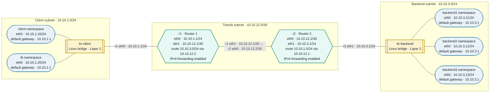

# Network Architecture

This diagram shows the seven network namespaces, the two Linux bridges, and the three subnets created by `setup.sh`. Interface addresses and routes reflect `README.md` and `routing.sh`. Bridges are Layer 2 switches and have no IP addresses assigned.

## Architecture and routing path

The client and load balancer share the `10.10.1.0/24` LAN through `br-client`; traffic between them stays on that subnet. For load-balancer traffic to a backend, the load balancer sends packets to its default gateway, Router 1 (`10.10.1.1`). Router 1 forwards them over the transit link to Router 2 (`10.10.12.2`), which delivers them to the backend subnet through `br-backend`. Replies use Router 2 as the backend gateway and follow Router 2's route to `10.10.1.0/24` via Router 1 (`10.10.12.1`). Both routers have IPv4 forwarding enabled.
